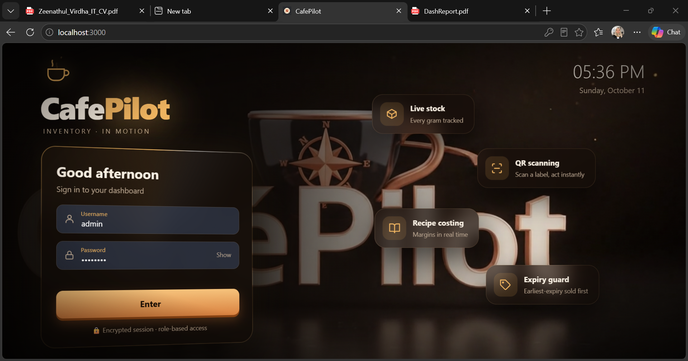
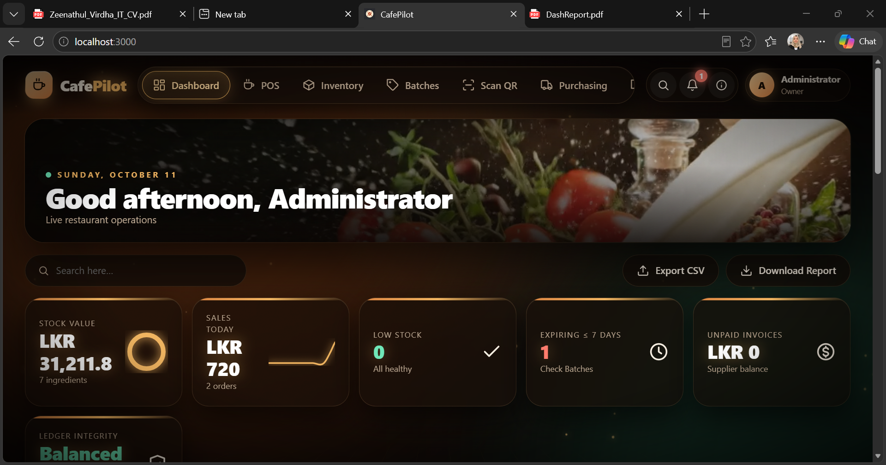
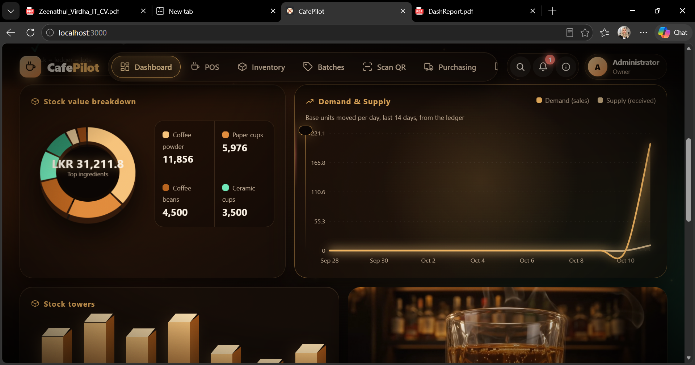
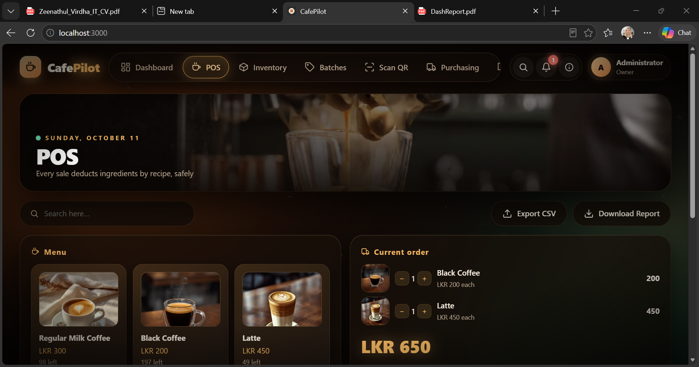
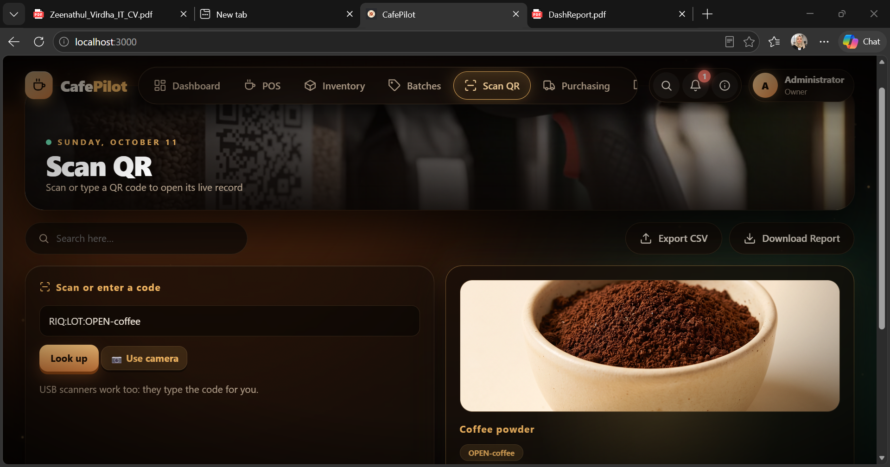
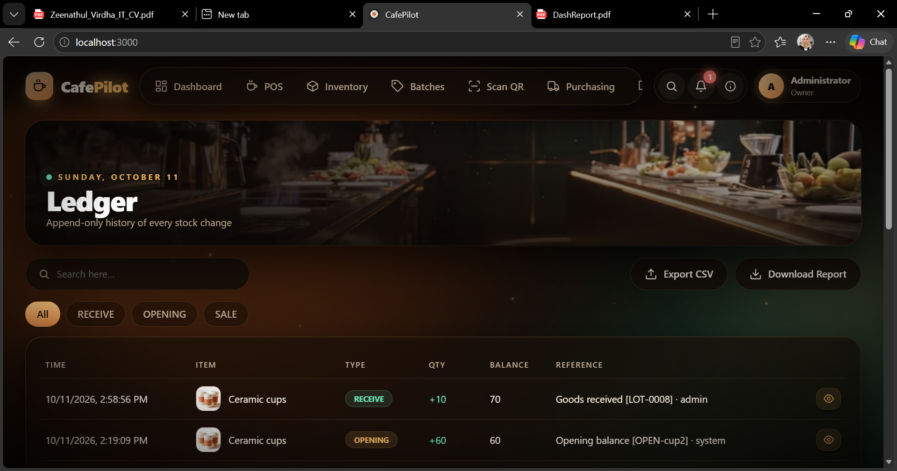
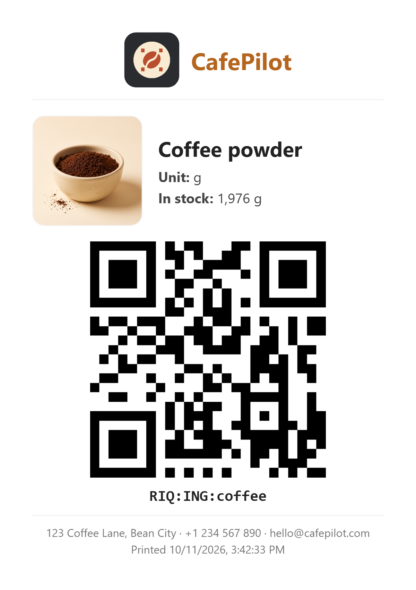

# CafePilot

**Smart cafe and restaurant inventory, POS, and QR-label system.**

A single small Node.js application for stock control with batches and expiry, a recipe-based POS, purchase orders, printable QR labels, an audit trail, role-based login, and professional printable reports with your company letterhead.

---

## Table of Contents

1. [Features](#features)
2. [Screenshots](#screenshots)
3. [Requirements](#requirements)
4. [Quick Start](#quick-start)
5. [Project Structure](#project-structure)
6. [Logging In and Roles](#logging-in-and-roles)
7. [Company Profile](#company-profile)
8. [Using the System](#using-the-system)
9. [Printing Reports](#printing-reports)
10. [QR Labels and Scanning](#qr-labels-and-scanning)
11. [Images and Assets](#images-and-assets)
12. [Environment Variables](#environment-variables)
13. [Tests](#tests)
14. [Deploying Online (Railway)](#deploying-online-railway)
15. [Backup and Reset](#backup-and-reset)
16. [Troubleshooting](#troubleshooting)
17. [Security Notes](#security-notes)

---

## Features

| Area | What it does |
|---|---|
| **Dashboard** | KPI cards (stock value, sales today, low stock, expiring lots, unpaid invoices, ledger integrity), stock value donut, 14-day demand and supply chart, 3D stock towers, recent movements |
| **POS** | Tap menu items with photos, see the current order with product images, pay once; ingredients are deducted automatically from each recipe |
| **Inventory** | Ingredients with unit, stock, minimum level, unit cost, and photo. Receive stock, record waste, search and filter |
| **Batches** | Lots with received date and expiry. Sales use the earliest-expiring lot first (FEFO). Expired lots are never sold |
| **Purchasing** | Purchase orders: order, receive (with accepted quantity and expiry), then pay the supplier. Paying never changes stock |
| **Recipes** | Cost per serving, selling price, margin, and food-cost percentage |
| **Scan QR** | Scan with a camera or USB scanner (or type the code) and see the live record with product image and details |
| **QR Labels** | Large printable labels with logo, product image, name, unit, QR code, and company details. A6, A5, or A4 sticker sheet. Download as image |
| **Reports** | Colourful A4 reports with letterhead, logo, title bar, KPIs, tables, totals, and signature lines |
| **Audit Trail** | Every login, change, and denied action is recorded |
| **Users and Roles** | Owner, Manager, Storekeeper, Cashier, Accountant |
| **Company Settings** | Company name, logo, address, phone, email, website, tagline, registration and tax IDs, footer note, currency |

Stock changes, ledger rows, and audit rows are committed together in one SQLite transaction. A `CHECK(stock>=0)` rule blocks negative stock. Sales are idempotent — double-clicking Pay never charges twice.

---

## Screenshots

### Login



### Dashboard — KPIs, stock value donut, and demand/supply



### Dashboard — charts and stock towers



### Point of Sale (POS)



### Scan QR — live record for a scanned label



### Ledger — append-only history of every stock change



### Printed QR label example



---

## Requirements

- **Node.js 18 or newer** (tested on 22)
- npm (comes with Node)
- A modern browser (Edge, Chrome, Firefox)
- Internet access in the browser for QR libraries (loaded from a CDN)

---

## Quick Start

```bash
npm install
npm start
```

Open **http://localhost:3000**.

On the very first run the terminal prints the admin password **once**:

```
*** FIRST RUN — login: admin / xxxxxxxx  (shown once) ***
```

Copy it. Or choose your own password before the first start:

```bash
# Windows (Command Prompt)
set ADMIN_PASSWORD=MyStrongPass1
npm start

# Windows (PowerShell)
$env:ADMIN_PASSWORD="MyStrongPass1"; npm start

# macOS / Linux
ADMIN_PASSWORD=MyStrongPass1 npm start
```

The password is only used when the database is created. To get a new one, delete `data.db` (this erases all data) or change it in the app.

---

## Project Structure

```
cafepilot/
├─ server.js            Express API, SQLite schema, roles, transactions, QR codes
├─ reports-api.js       GET /api/reports/full (all orders, ledger, POs, batches)
├─ package.json
├─ Procfile             (optional) web: node server.js — only for hosting
├─ data.db              SQLite database (created on first run)
├─ README.md
├─ install-addon.js     one-time installer for the reports add-on
├─ fix-catalog.js       one-time catalog cleanup script (optional)
├─ update-images.js     one-time image / catalog update script (optional)
├─ screenshots/         images used by this README
├─ test/                automated tests (npm test)
└─ public/
   ├─ index.html        the whole web app (single page, vanilla JS)
   ├─ reports.js        print engine: reports, QR labels, downloads
   └─ assets/           your images and videos
```

---

## Logging In and Roles

Log in as `admin`, then create staff under **Users**.

| Role | Can do |
|---|---|
| **owner** | Everything |
| **manager** | View, sales, stock, purchase orders (create, receive, pay), audit, reports, users, company settings |
| **storekeeper** | View, stock, create and receive purchase orders |
| **cashier** | View and sales (POS) |
| **accountant** | View, pay suppliers, audit, reports |

Permissions are enforced on the server (see the `P` table in `server.js`), not just hidden in the UI. Denied attempts are logged in the audit trail.

---

## Company Profile

Go to **Users → Company Settings** (needs the `users` permission: owner or manager) and fill in:

| Field | Used for |
|---|---|
| Company Name | Header of every report and label |
| Logo URL | Big round logo on reports, small logo on labels. Example: `/assets/Creating_app_symbol_for_Restaurant.jpg` |
| Address, Phone, Email, Website | Letterhead and footer |
| Tagline | Shown under the company name |
| Registration No., Tax / VAT ID | Letterhead |
| Report footer note | Printed at the bottom of every report |
| Currency | Currency shown on reports (default `LKR`) |

Click **Save Settings**. Changes appear on the next printed report or label.

---

## Using the System

**Receive stock** — Inventory → pick an item → receive. Enter quantity, optional expiry, and lot code. A lot is created and the ledger records it.

**Sell** — POS → tap items to add them to *Current order* (each line shows the product photo, name, and price) → **Pay & deduct stock**. Ingredients are taken from the earliest-expiring lots first.

**Buy** — Purchasing → *New purchase order* → *Receive* when goods arrive (enter accepted quantity and expiry) → *Pay supplier* when the invoice is settled.

**Record waste** — Inventory → waste action. It appears in the ledger and in the Consumption & Waste report.

**Check records** — Ledger shows every stock movement (append-only). Audit shows who did what and when.

---

## Printing Reports

Every page has a **Download Report** button (or press **Ctrl+P**). It opens the browser print dialog with a clean report, without menus, buttons, or quick actions.

- Choose **Save as PDF** (or Microsoft Print to PDF) as the printer, **A4**, and turn on **Background graphics** if your browser has that option, so the colours print.
- Each report has: gold header band, big round logo, company name and contact details, a coloured title bar (e.g. **INVENTORY REPORT**), report number, date, time, prepared-by, business date, currency, coloured KPI cards, tables with totals, notes, signature lines, and a footer.

| Tab | Report Title |
|---|---|
| Dashboard | Dashboard Report |
| Inventory | Inventory Report |
| POS / Orders | Sales Report |
| Batches | Batch & Expiry Report |
| Purchasing | Purchase Order Report |
| Recipes | Recipe Costing Report |
| Reports | Consumption & Waste Report |
| Ledger | Stock Movement Ledger (respects the filter chip) |
| Audit | Audit Trail Report |
| Users | Staff Directory |

Reports load up to 1000 orders and 2000 ledger rows through `/api/reports/full`.

---

## QR Labels and Scanning

**Print a label:** Inventory or Batches → QR button → choose the layout:

- **Large label (A6, 100 × 148 mm)** — one label per page, QR about 60 mm
- **Extra large label (A5, 148 × 210 mm)**
- **Sticker sheet (A4)** — 8 labels per page
- Set **Copies**, then **Print / Save as PDF**, or **Download label as image** (PNG)

The label shows the logo and company name, product image, name, unit in full (e.g. "grams (g)"), stock, minimum, lot and expiry (for lots), the QR with its code text, the company contact line, and the print date and user.

**Scan:** Scan QR tab → type, paste, use a USB scanner, or press **Use camera**. The result shows the product photo, status (low or in stock), quantity, minimum, unit cost, stock value, and its lots.

Codes look like `CP:ING:coffee` (ingredient) and `CP:LOT:LOT-0001` (lot). Older `RIQ:` codes still work.

QR codes hold only an ID. Quantities are always read live from the database, so an old printed label never shows wrong numbers.

---

## Images and Assets

Put your images and videos in `public/assets/` and reference them as `/assets/<filename>` (for example `/assets/Latte.png`). The database stores the full path in the `img` column of ingredients and recipes.

- If an image is missing or the path is wrong, the app shows the first letter of the item instead of a broken picture.
- Videos used by the UI (login, banners): `drinks.mp4`, `Barista_preparing.mp4`, `Restaurant_kitchen_inventory.mp4`, `Scanner_scanning_QR_label.mp4`, `Restaurant_ingredients_floating.mp4`, `Chef_plating_gourmet_restaurant.mp4`.

---

## Environment Variables

| Variable | Default | Meaning |
|---|---|---|
| `PORT` | `3000` | Port the server listens on (hosting sets this for you) |
| `DB_FILE` | `./data.db` | Path of the SQLite database file. Point it at a persistent disk when hosting |
| `ADMIN_PASSWORD` | random | Password for the first `admin` account (used only when the database is first created) |

For hosting, the last line of `server.js` should be:

```js
const PORT = process.env.PORT || 3000;
if (require.main === module) {
  app.listen(PORT, '0.0.0.0', () => console.log('CafePilot running → http://0.0.0.0:' + PORT));
}
```

---

## Tests

```bash
npm test
```

Runs the automated tests in `test/` with Node's built-in test runner. Tests use a temporary database, never your `data.db`.

---

## Deploying Online (Railway)

### Step 1 — Push to GitHub

```bash
git init
git add .
git commit -m "CafePilot"
git branch -M main
git remote add origin https://github.com/YOURUSERNAME/CafePilot.git
git push -u origin main
```

Create `.gitignore` first with these lines so your database and modules are not uploaded:

```
node_modules
data.db
data.db-shm
data.db-wal
*.pdf
.env
```

### Step 2 — Deploy on Railway

1. Go to **https://railway.app** → **Login with GitHub**.
2. **New Project → Deploy from GitHub repo** → choose `CafePilot`.
3. Railway runs `npm install` and `npm start` automatically.

### Step 3 — Generate your public link

Your service → **Settings → Networking → Generate Domain**.

### Step 4 — Keep your data (Volume)

Your service → **Settings → Volumes → Add Volume**, mount path `/data`.

Then → **Variables**, add:

- `DB_FILE` = `/data/data.db`

Without a volume, the database is wiped on every redeploy.

### Step 5 — Set the admin password

**Variables**, add:

- `ADMIN_PASSWORD` = your strong password

This is used only when the database is first created. If the database already exists, the old password stays.

### Step 6 — Share

Send the URL, the username `admin`, and the password privately.

**Procfile:** optional. Railway already runs `npm start`. If you keep one, it must contain exactly `web: node server.js`.

Railway gives you HTTPS automatically, which camera scanning needs.

---

## Backup and Reset

- **Back up:** stop the server and copy `data.db` (and `data.db-wal` / `data.db-shm` if present). On Railway, download `/data/data.db` from the volume.
- **Restore:** stop the server, put the backup file back, start again.
- **Reset everything:** delete `data.db`, `data.db-wal`, and `data.db-shm`, then start the server. A new admin password is created.

---

## Troubleshooting

| Problem | Fix |
|---|---|
| **Report PDF is blank** | Use the current `reports.js`, then Ctrl+F5 |
| **Colours missing in the PDF** | Turn on *Background graphics* in the print dialog |
| **Report has no logo or images** | Check the path in Company Settings or the `img` column. Open `http://localhost:3000/assets/<file>` to test |
| **QR does not appear** | The browser could not reach the CDN. Check the internet connection |
| **Camera will not start** | Needs HTTPS or `localhost` and camera permission |
| **Changes to files are not showing** | Hard-refresh with Ctrl+F5 and bump the `?v=` number |
| **Forgot the admin password** | Delete `data.db` (erases data), or ask another owner or manager to create a new user |
| **`npm install` fails on better-sqlite3** | Use Node 18–22 (LTS). Delete `node_modules`, run `npm install` again |
| **Port 3000 already in use** | Close the other server, or run with `set PORT=3001` then `npm start` |
| **Railway app not reachable** | `server.js` must listen on `process.env.PORT` and `0.0.0.0` |
| **Data disappears after redeploy** | Add the volume and `DB_FILE` as described above |

---

## Security Notes

- Passwords are hashed with scrypt. Sessions use an HTTP-only cookie.
- Role permissions and audit logging are enforced on the server.
- Before real use over a network: serve over HTTPS (hosting platforms do this for you), set a strong `ADMIN_PASSWORD`, take regular backups, and consider moving from SQLite to PostgreSQL for several outlets.
- Never commit `data.db` or passwords to GitHub.

---

© CafePilot. Built with Node.js, Express, SQLite, and vanilla JavaScript.